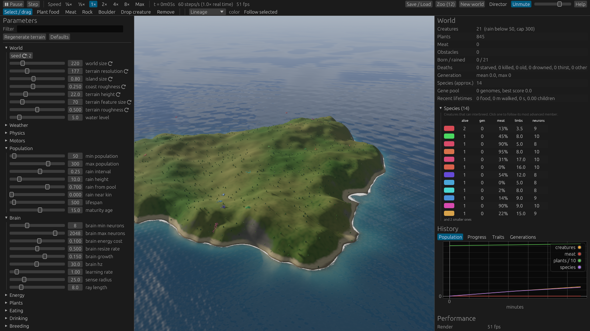
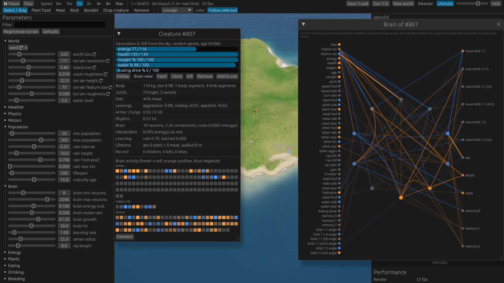
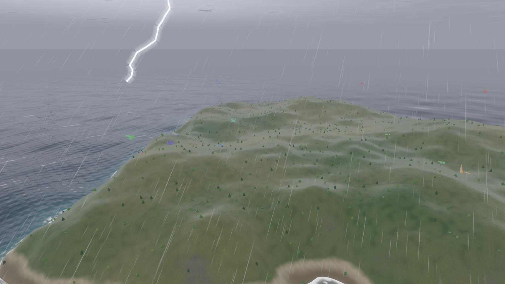
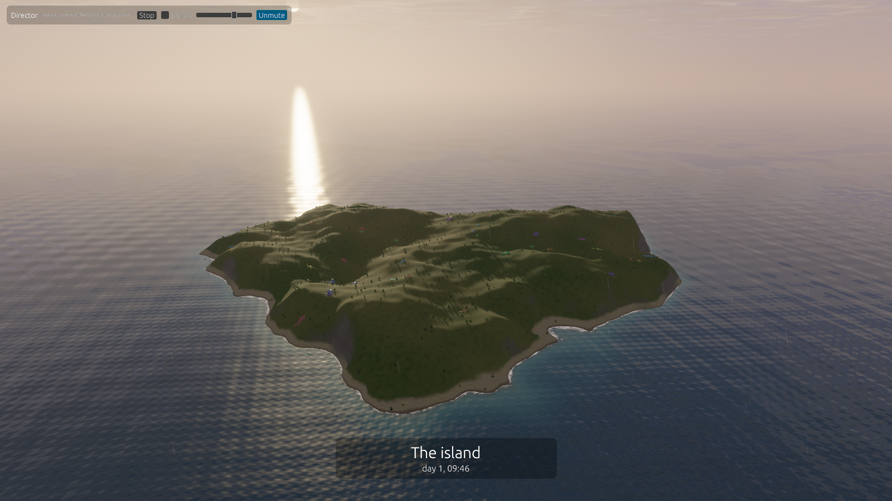
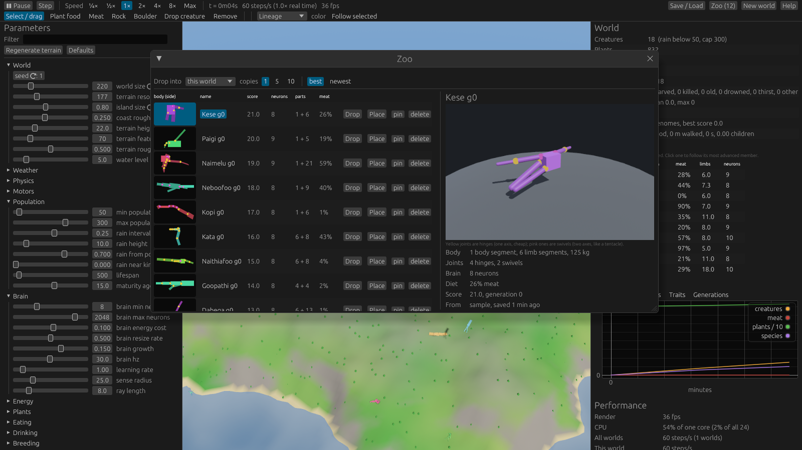

# evolve

A 3D evolution simulator. Creatures with randomly built bodies (segmented trunks, multi-jointed
legs, arms, tentacles and paddles) live on an island in an ocean, with hills, plants, weather and a
day/night cycle. Each one is driven by a neural network. They search for food and water, breed,
fight and eat the remains, and over generations they learn to move their bodies to get around,
on land and in the water. Everything physical runs through a real physics engine.











## Run it

```
cargo run --release -p evolve
```

The first build compiles Bevy and takes a few minutes. Options:

```
cargo run --release -p evolve -- --load ~/.local/share/evolve/saves/world.evo
cargo run --release -p evolve -- --seed 42 --speed 4 --set min_population=80 --set water_level=8
```

Sound needs the ALSA development files to build (`sudo apt install libasound2-dev` on
Debian/Ubuntu). Without them, the build fails rather than running silently.

The window opens through XWayland. For a native Wayland window, install `libwayland-dev` and
build with `--features wayland`.

A fresh world starts with random bodies that mostly flail and starve. Real walking usually
appears after 40–60 simulated minutes, which is a few minutes of wall time at **Max** speed. To
skip ahead, evolve a world with the headless runner, which runs as fast as the CPU allows, prints
progress, and saves the result for the app to load:

```
cargo run --release -p evolve-sim --bin evolve-headless -- --minutes 120 --report 300 --save ~/.local/share/evolve/saves/evolved.evo
```

## Controls

| | |
|---|---|
| Right-drag / middle-drag / scroll | orbit / pan / zoom |
| WASD, Q/E | move, turn |
| F | follow the selected creature (opens its brain view) |
| C | director: the camera runs itself (any camera input takes over again) |
| M | mute; the volume slider is in the toolbar |
| 1-8 | tools: select and drag, plant food, meat, rock, boulder, drop creature, remove, stones (the powers are in the Powers menu) |
| Left click | use the tool. With Select, click a creature to inspect it, or hold and drag to carry it (scroll lifts it) |
| Space, `.` | pause, single step |
| + / - | speed (¼× up to Max) |
| F5 / F9 | quick save / quick load |
| F12 | screenshot |
| R or F10 | start / stop recording a video (also the Record button, in the toolbar and in the director's bar) |
| H | help: a guide to the controls and to every dynamic of the world |
| Delete, Esc | remove selected creature, deselect |

**The director** (toolbar button, C, or start with `--director`) is a camera for just watching.
- *What it picks:* it looks for something worth seeing and frames it. Candidates are a kill, a
  birth, the first of a new generation, a fight, a creature in trouble in the water, a splash, the
  best swimmer, the fastest steady walker, the most evolved creature, the biggest brain, the
  strangest body, or the island itself at sunrise, at sunset, at night and in storms.
- *How it moves:* it circles the subject slowly, then glides to the next thing, flying up and over
  for long moves. It follows the subject's center of mass on a damped spring (as does F), so a
  creature thrashing about doesn't shake the view.
- *Pace:* each shot gets its own length, mostly 10 to 25 seconds, and now and then it lingers two
  or three times as long. Captions fade after about 10 seconds, so a long shot has a clean screen.
- *Variety:* it avoids repeating itself, and once a shot is half over it cuts away for a kill or
  a record somewhere else (births are too common to cut in for).
- *Paused:* a notice at the top of the screen says so (Space runs it again).
- *Screen:* a caption says what you're looking at, and the panels hide for a clean screen (tick
  "panels" to keep them).
- *Taking over:* moving the camera yourself, or pressing C, hands control back.

**Sound** is synthesized as it plays; there are no sound files.
- *Ambience:* wind that rises with the weather and the camera's height, rain, and surf where the
  view takes in the shoreline. There are no birds or insects here; the only voices are the
  creatures' own.
- *Thunder:* follows each lightning flash after the time sound takes to travel from it, with a
  crack when close, plus distant rumbles in storms.
- *Calls:* each creature's calls in its genetic voice: FM tones that can be pure, metallic or
  bubbling, wavering or steady, clean or rasping, gliding up or down with the pitch its brain
  picks.
- *Events:* thuds when bodies hit the ground (louder for harder falls, deeper for heavier parts),
  bites, kills, birth chimes, a rising arpeggio for a new generation, splashes and drowning
  bubbles.
- *Distance:* events are full strength within 6 m of the camera and fade as 1/distance beyond:
  10 times quieter at 60 m, as sound does in open air. They come from where they happen (left or
  right).
- *Balance:* every sound has a target loudness, measured by a test with the broadcast loudness
  standard (ITU BS.1770, LUFS) and kept within 1.5 dB. Close thunder is loudest (−12), then
  hard landings and kills (−16), bites and splashes (−20), and a gale (−22). Heavy rain sits under
  everything at −27, and birds and crickets lower still.
- *Device:* plays through PipeWire or PulseAudio when available, so it follows the desktop's
  choice of speakers, and reconnects by itself if the device reports an error, or stops asking for
  sound for 4 seconds after it had started. (A device can take a while to start.)
- *Controls:* M or the toolbar mutes; the slider next to it sets the volume. `--mute` starts
  silent, and screenshot runs are always silent.

**The clock** at the top of the screen, in every view, shows the day (counting from the world's
first) and the time of day.

**Powers.** The Powers menu on the toolbar's second row calls down acts of god on the island
(the one in hand shows on its button).
- *Call a storm* brings a storm over the whole island for four minutes: it builds over half a minute
  to a downpour and a gale with lightning, and dies away over the last 45 seconds. The menu then
  offers to calm it early (the time left also shows beside the menu). Plants grow faster in it, streams swell and lakes
  fill. A saved world keeps its storm.
- *Meteor*: click a spot and a meteor streaks down onto it, roaring, trailing fire and
  smoke. It blasts out a crater 4 m across the bowl, its earth thrown up into a rim (earth is
  conserved, and the crater can't go deeper than `dig_depth`), kills whatever it lands on, hurts
  and throws everything within 16 m (up and away, harder the closer), scatters boulders, and
  burns the plants nearby. A fireball, a mushroom of smoke, a ring of dust and flying rock follow,
  the view jolts, and the crater burns for a while. Creatures thrown by it land unhurt by the
  landing itself: nothing in the world takes fall damage.
- *Whirlwind*: click a spot and a whirlwind touches down there. It spins up in place over
  a few seconds, then wanders the island for 25 seconds, turning back from the sea and the
  world's edge. Its air circles the core at up to 22 m/s, draws inward and rises through the
  middle: every body part within 14 m is dragged toward that air, and in the core it's held up
  against its weight, so creatures and boulders are lifted, whirled round a few meters up and
  flung out (the lift fades between 6 and 18 m up). It tears up the plants and meat in its path,
  roars as it nears the camera, and is drawn as a funnel of dust with debris and leaves circling
  low and a cloud churned up at its foot. A saved world keeps its whirlwinds.
- *Raise land / Lower land*: hold and sweep (the brush slider sets how wide) to lift or sink the
  land about 2 m a second at the brush's middle. Out of the sea, raised land is new land; sunk
  below it, the sea comes in. This is the world remade, so creatures dig relative to the new
  ground.
- *Spring*: click to make an eternal spring. It pours out a stream as big as a hillside of 3,000
  m² gives in steady rain, whatever the weather. Its water creeps downhill at about half a meter
  a second into the first hollow in its way and fills it (about 0.35 m³ a second, a pond within
  minutes); only when that is full does it spill over the rim and run on, into the next hollow
  or down to the sea, wearing a channel wherever it runs.
  Click a spring to stop it. Springs bubble and froth where they rise, and saves keep them.
- *Earthquake*: click a spot and the land splits across your view through it: a jagged crack of
  raw earth up to 3 m deep opens, the ground on one side heaves up nearly a meter, dust bursts
  from it, and for six seconds everything within 70 m shakes (and so does the view).
- *Land from the sky*: click a spot and a clod of earth topped with grass tumbles down onto it,
  trailing dust. A hill 9 m across rises where it lands, standing out of the sea if it fell into
  it, so it adds to the island. It crushes what it lands on and throws what's near.
- *Manna*: click a spot and food falls from heaven: sixteen full-grown plants in a ring 6 m
  across, under a soft shaft of golden light and drifting golden flakes, to a choir.
- *Tsunami*: click a shore and a great wave rolls in from the open sea beyond it, toward the
  island's middle, at 12 m/s: about 7 m high at sea, it builds over the first seconds and is spent
  by the end of its 24. Its water stands up to the crest's height over the ground it reaches
  (higher ground stays dry), and in it creatures float and hold their breath, and are carried
  off: water drag is against the wave's own flow, so it sweeps along what it covers. Plants and
  meat under more than 0.8 m of it are washed away. Drawn as a wall of water with a foaming
  crest, spray and foam thrown off it wherever it's above ground, to a deep roar.
- *Totem*: pick love, war or fear beside the tools, then click to raise one (click a totem to take
  it down). It sways every creature within 16 m (fully over the inner half), overriding its own
  leanings:
  - *Love*: the mating drive fills, the wait between matings shrinks to a second or two, the urge to mate
    is turned on, and caution about being fed enough is forgotten. Each child still has to be
    paid for, so love can't make energy from nothing.
  - *War*: the urge to bite is turned on, and each is drawn toward the nearest other creature.
  - *Fear*: it hurts, it feels bad (so creatures learn to keep away), and they're driven off.
  - Totems are carved poles with a glowing head (pink, red or violet), what they stir drifting
    round it, and their reach marked by a faint ring on the ground. Saves keep them.

**Miracles.** When the hand of god (you) touches a creature, it shows.
- *Feed* is a blessing: a shaft of golden light comes down from the sky onto the creature, which
  glows in it while golden motes rise around it and fall down the shaft, to a choir's chord.
- *Kill* is a smite: lightning out of a clear sky strikes it (the flash and the thunder of a strike
  that close), sparks fly, and fire burns where it fell, shedding embers, for a few seconds.
- *Remove* takes it up: a white shaft, and a rush of light rising away with it.
- Each casts real light on the ground around it, so they glow best at night, and they keep their
  colors through the night's cool grading. With the lightning checkbox off (in Graphics), a smite
  still strikes but doesn't flash the whole sky.
- `--miracle KIND:N` (with `--select-first` and `--screenshot`) works one on or near the selected
  creature N frames before the screenshot: bless, smite, take, meteor, whirl, quake, land,
  spring, manna, love, war, fear or tsunami.

**Leaders** (in the right panel) names who's ahead right now: top score, oldest, most evolved,
biggest brain, fastest, farthest travelled, biggest eater, most children, best hunter, heaviest
and best swimmer. Click one to go and follow it.

**Recording.** R, F10 or the Record button (in the toolbar, and in the director's bar when the
panels are hidden) records the window to
`~/Videos/evolve-<date>-<time>.mp4`, with whatever panels and overlays are showing, at 30 frames
a second in real time. It encodes on the GPU (NVENC) through `ffmpeg`, falling back to x264, and
drops frames rather than slowing the app if encoding falls behind. A window resize starts a new
file. `--record FILE` records from launch. There is no sound in the video.

**The brain view** opens when you follow a creature (F, or Follow in its inspector), or with the
inspector's Brain view button.
- *Layout:* the senses its body uses are on the left and the actions it can take on the right. The
  (up to) 40 hidden neurons most tied to them sit in a ring between.
- *Connections:* the strongest connections are drawn in orange (excite) or blue (inhibit), thicker
  for stronger weights and brighter while signal is flowing through them.
- *Live:* nodes light up with their current activity. Hover a node for its name and value.
- *Neural tab:* the same brain drawn as living tissue (neural_view.rs). Sensory neurons with
  receptor endings sit on the left, hidden neurons with branching dendrites in the middle, and
  motor neurons on the right, their axons ending in end plates on the muscle they drive. Each
  neuron fires as often as it is active. Spikes run down its axons to synapses, warm where they
  excite and cool where they inhibit, and the next cell body glows as they arrive. Thicker axons
  are stronger connections. `--neural-view` with `--select-first` opens it, for screenshots.

**The genome view** (Genome in a creature's inspector) lists every gene of the creature: its body
(size, torso, spine and each of the six limb genes, including the ones switched off), its
instincts and upkeep (diet, aggression, libido, appetite, armor, lungs, rhythm), its learning
genes, its voice and its brain. Each gene has a bar for where it sits in its possible range and a
line on what it does to this creature.

**Help** (H, or the toolbar's Help) is a guide to the controls and to how everything works:
bodies, brains, learning, energy, food, water, breeding, fighting, evolution, land, weather,
voices and worlds. Its numbers are the current parameters, so it follows your changes.

**The zoo** (toolbar button, or start with `--zoo`) keeps the best creatures from every world
across sessions, in `~/.local/share/evolve/zoo`. Every `zoo_interval` simulated seconds (default
5 minutes), each world, background worlds included, stores its current best genome, and the
weakest unpinned ones are pruned past `zoo_max_entries`. **Add to zoo** in a creature's inspector
stores (and pins) one by hand. From the Zoo window you can **Drop** copies from the sky into this
world, a background world or every world, or **Place** them where you click. Like every creature
that appears in a world, each copy is a slightly mutated variant (a child of the zoo creature).
Drop 5 or 10 at once if you want them to breed: they're close enough kin to mate. Load another world
and its zoo is still there. A new world starts with `zoo_seed_fraction` (70%) of its population
from the zoo, in pairs of copies of randomly chosen creatures so they can breed, and with the
same genomes in its gene pool. The rest are random. Only creatures scored under today's rules
seed a world (until there are some, it starts all random): those that won under older rules
(free children, limbs that couldn't push) would only bring back what those rules rewarded. You
can still drop any of them by hand. Zoo scores worked out under older rules are marked with a *
and listed after newer ones. When the zoo is full (500), those go
first, then the weakest; pinned ones never.
- Pruned and removed creatures go to `zoo/trash` (the newest 500 are kept there), not deleted.
- Only one evolve at a time can change the zoo. A second one (another window, or
  `evolve-headless` with `EVOLVE_ZOO_DIR` pointing at the real zoo) can read it but stores nothing.
- If `index.json` can't be read, it is renamed `index.json.bad-<time>` and the zoo is rebuilt
  from the genome files (scores start at 0, marked *).
- Each row shows a side view of the creature's body.
- Click a row to see it in 3D, spinning slowly; drag the picture to turn it.
- Joints are marked: yellow for hinges, pink for swivels.
- Next to the picture: its body segments, limb segments, joint kinds, brain size, diet and where it
  came from.

The right panel lists the species (clusters of creatures that can interbreed) with their size,
generation, diet, limbs and brain size. Click one to follow its most advanced member.

Every parameter is in the left panel and takes effect immediately. The ones marked ⟳ shape the
terrain and apply when you press **Regenerate terrain**, which keeps all the life. **New world**
starts over. **Save / Load** lists the worlds in `~/.local/share/evolve/saves`. A save holds the
complete state, physics included, so a world resumes mid-stride exactly where it was.

## How it works

**Genome.** The body is a torso (the head end, with eyes and mouth) followed by a spine of 0 to
5 more segments, so a creature can be one block, a caterpillar or a snake. The spine gene sets the
segments' size and taper, which way they bend (side to side or up and down), their range and
strength, and whether the joints are hinges or swivels. Six limb genes follow. Each can be switched
on or off. Each grows from any body segment, or from the tip of an earlier limb. Each has 1 to 3
segments (thigh, shin, foot; upper arm, forearm, hand), with tapering size and a resting bend at
the knees. A gene also sets the limb's direction, hinge axis, range of motion, motor strength, and
whether its tip is a flat paddle. A limb can be *mirrored* to make a symmetric pair, and limbs
hanging off a mirrored limb are mirrored with it. A body is capped at 24 parts. Traits cover body
size, diet (plants or meat), built-in leanings toward eating, mating and attacking, armor, lung
capacity, the frequency of an internal rhythm, and how fast the brain learns. Lineages have their
own color hue, which drifts slowly.

**Joints.** A creature's body is one articulation (a rapier multibody): its joints are solved in
joint coordinates, so they can't drift apart, and a limb pushing on the ground has to lift the
body's real weight. Every joint has a genetic range of motion that the physics enforces.
- *Hinges* bend about one axis. They are the cheap kind. A limb's knees bend mostly one way (a
  quarter of the range the other way), like real knees and elbows.
- *Swivels* bend about two axes, with twisting along the bone locked: a hip or shoulder, or, all
  the way down a limb, a tentacle. Each is two hinges in series through a small knuckle (a
  universal joint). They're more flexible, but each unit of work costs `swivel_energy_cost` (2x)
  what a hinge's does.
- *Why a multibody:* until 2026-10-22 joints were separate constraints, and rapier's solver
  pumped energy into any body with many joints on one part (six legs on a torso was enough):
  bodies flung themselves about even with their muscles off. The best creatures in the zoo had
  evolved to ride it, bouncing over the ground off the ground three-quarters of the time. Now
  they barely move until evolution finds them a real gait. The physics costs about twice as
  much (about 3 ms a step for 50 creatures: one substep of 8 passes).

**Physics on many cores.** Rapier solves a world's articulations on one thread, so the world's
physics is split into `physics_shards` (12) physics worlds stepped in parallel, each on a thread
of its own. Every tenth of a second, creatures and obstacles are regrouped: anything whose parts'
bounding boxes come within 0.6 m of each other shares a world (so creatures that touch collide,
fight and mate as before), groups stay where most of their members are, and whole groups move out
of busy worlds to even the load. A creature moves between worlds exactly as it is (pose, joint
angles, motors, every velocity). Eyes see into every world. With 790 creatures this runs about
4x faster than one world (71 steps a second on a Core Ultra 9 285K, about 1.2x real time).
Background worlds run at `background_population` (a quarter) of this world's population and at a
lower CPU priority, so they use spare cores without starving this one.
- *Speed:* the angle a joint aims for moves at most `max_joint_speed` (8 rad/s for a half-meter
  segment; longer segments slower, shorter ones faster, like pendulums). The brain can change its
  mind 30 times a second, but a limb swings rather than snapping back and forth in a blur.

Every joint axis has its own fixed brain channel tied to its gene, so growing a knee on one leg
never rewires another.

**Brain.** A recurrent network: every hidden neuron feeds back into every other one each tick,
so the brain keeps a state between ticks (memory, rhythms, plans). Weights are stored as f16.
Creatures made from scratch start with `brain_min_neurons` (64). Brains then grow or shrink
through mutation, by about 20% at a time (`brain_resize_rate`, with a slight upward bias set by
`brain_growth`), up to `brain_max_neurons` (4096; the slider goes to 8192). Crossover lines
parents up neuron by neuron. A brain costs `brain_energy_cost` per million connections per
second. Connections grow with the square of the neuron count: a 2048-neuron brain has 4.3 million
of them and costs about as much as resting metabolism, so a big brain has to pay for itself.
On 2026-10-22 every brain was doubled. Genomes from before that (in the zoo, the gene pool or an
older save) double their neurons once as they come into a world; the new neurons are wired in
weakly, so what the brain already does carries over.
- *Senses (132):*
  - the rhythm, energy, health, oxygen, thirst and age;
  - a mating drive: an urge that builds while the creature is mature, past its cooldown and fed
    enough to breed (over `mate_drive_time`, faster with a high libido gene), fades when it goes
    hungry, and resets after mating;
  - hearing: the direction and loudness of the loudest call it can hear, its pitch, and how much
    the caller's voice is like its own;
  - how much earth it's carrying;
  - posture and speed;
  - the direction and closeness of the nearest plant, meat, open water and creature;
  - how related that creature is, its size and aggression;
  - the direction of the nearest potential mate (mature and close enough genetically);
  - the direction and closeness of the nearest loose stone it could lift, and whether it holds
    something in its mouth;
  - three obstacle rays, pain, how submerged it is, and three memory values;
  - every joint angle (82 channels, most of them unused by any one body).
- *Actions (94):* a target angle for every joint axis (82 channels), eat, attack, mate, call
  (and its pitch), dig, pile, grip, throw, and memory.
- *Voices:* every creature has a voice of its own, set by four genes: natural pitch, timbre (how
  inharmonic and bright), rasp and warble. Kin sound alike.
  - *Calling:* a creature calls when its brain says so, louder or softer and pitched up or down.
    A full call carries `call_range` (40 m) and costs `call_cost` energy.
  - *Hearing:* creatures hear the call that sounds loudest from where they are.
  - *Meaning:* what calls come to mean (a mating call, a warning, nothing) is up to evolution.
  - *Old creatures:* upgraded from older versions they start silent, with a voice of their own
    worked out from their genome.
- *Lifetime learning:* creatures learn while they live, by trial and reward (reward-modulated
  node perturbation with eligibility traces):
  - *Trying things:* each joint's movement wanders a little around what the brain asks for (the
    `explore` gene, scaled by `exploration`).
  - *Remembering what was tried:* each output connection keeps a fading trace of the recent
    variations and the brain activity behind them (the `trace_time` gene: how many seconds back
    a reward can reach).
  - *Learning from surprise:* when things go better than the creature's running average, the
    traced variations are written into a learned layer on top of the inherited output weights;
    when worse, the opposite.
  - *What feels good:* eating, mating and drinking in proportion to need; getting closer to food
    when hungry or water when thirsty (weighted by the `seek` gene). Pain feels bad.
  - *How long it lasts:* lessons fade back toward the inherited wiring over `learned_memory`
    (half-life 5 minutes). The `plasticity` gene sets how fast each creature learns, and
    `learning_rate` scales everyone.
- *Inheriting lessons:* when a creature breeds, `learned_inheritance` (half, by default) of what
  it has learned is written into the genes it passes on. The same goes for a life good enough
  for the gene pool, so creatures that fall from the sky inherit too. Lineages can build on what
  their ancestors figured out, while evolution still decides how much each one explores, how
  far back it remembers, and what it finds rewarding.

**Energy and water.**
- *Energy* comes only from eating: plants, or meat in proportion to the diet gene.
  - *What it costs:* it drains with body mass (mass^0.75), brain size, armor, lung capacity,
    calling, and the mechanical work the joint motors do (double for swivels): each motor's
    torque (what it takes to swing the limb beyond it as asked, up to the motor's strength)
    times how fast the joint turns. (Rapier doesn't report a multibody's motor impulses.)
  - *Motor work:* until 2026-10-22 a bug meant motor work cost nothing, so flailing was free and
    tentacles were no dearer than hinges. Now ordinary movement costs little and a creature
    thrashing at 80 W per kg pays about twice its resting metabolism.
  - *Starving:* a creature with no energy starves.
- *Strength:* each joint's motor is a servo. It holds the angle the brain asks for against any
  load up to its strength, `motor_torque_per_kg` (6) N·m per kg of body times the limb's strength
  gene, and pushes with all of it once the joint is forced `motor_reach` (0.2 rad) off target.
  It's damped at twice critical for the limb it swings (`motor_damping_ratio`): at once critical,
  some bodies with several swivels in a row shook themselves apart (a limb at 1,700 m/s).
  - *Why servos:* until 2026-10-23 the motors were rapier's default kind, whose spring scales with
    the inertia of the limb it swings. A light leg planted on the ground could push with only a
    sliver of its strength, however strong, so creatures flapped their limbs without moving
    themselves, and raising the strength did nothing (doubling it on 2026-10-22 changed nothing:
    the limit was never reached). With servos, random creatures move their bodies 2.4 times as
    fast (median 0.24 m/s against 0.10), with no faster limb tips (no flinging).
- *Breath:* muscles burn oxygen in proportion to their power per kg (`exertion_oxygen`), and a
  creature breathes it back in while its head is above water (`breath_rate`, scaled by the lung
  gene). Hard work can outpace breathing. Below 30% breath its muscles weaken, so a sprinter must
  pace itself. Underwater it holds its breath (`breath_time`), and drowns when that runs out.
  Pushing for real costs real oxygen: with servos, random creatures (which flail as hard as they
  can) were out of breath 58% of the time, so `exertion_oxygen` went from 0.006 to 0.004 (47%).
  Evolved creatures pace themselves; before servos one evolved world was short of breath 6% of
  the time.
- *Thirst:* a full creature runs dry in `thirst_time` (6 simulated minutes) and then loses health.
  Putting its mouth in water refills it in about two seconds, and rain helps a little. Any water
  will do.
- *Health* drops from bites, from drowning (holding breath underwater too long) and from thirst,
  and regenerates slowly.

**Breeding.** A mature, willing creature with enough energy that is near a genetically close
(`species_threshold`), willing partner produces a child. The partner only needs half the energy
bar. The genomes cross over, then mutate. The parents pay for the child's body, at the meat it
will be worth when it dies (`meat_per_mass` per kg, split between them), then each gives it part
of what it has left as its energy. Pairs that can't pay for the body and still give the child
`min_child_energy` don't breed. Without this, crowds of meat-eaters once lived on their own
dead: every birth was a free body and every death left meat, so they gathered in heaps and bred
without ever leaving. Genetic distance splits the population into species that can't
interbreed. Breeding alone is an optional parameter.

**Combat.** A creature that touches another with its torso (its head; the eyes show which end)
and wants to attack bites it. Damage depends on the size ratio and the target's armor. Biting
costs energy and has a cooldown, and the target can bite back. The dead leave meat where their
body parts were, and the meat rots over time.

**Rain and the gene pool.** When the population drops below `min_population`, creatures fall
from the sky. Most are bred from a hall of fame of the most successful genomes seen recently,
and the rest are random.

A life is scored by what it achieved, in "plants' worth":
- *Eating:* 1 per plant's worth of food or meat.
- *Hunting:* 3 per kill.
- *Breeding:* 0.5 per child, plus 1 per plant's worth of energy given to children.
- *Travelling:* 1 per 50 m of net progress.

Lasting long earns nothing by itself. Children must start with at least `min_child_energy`.
Before both rules, tiny limbless specks that bred where they landed topped the rankings: their
energy store was so small that one bite made them "well fed" enough to breed, and every child
scored 4 points. The inspector shows a creature's score and its breakdown. The director and the
species panel spotlight the best scorer.
Distance counts net progress over 5-second windows, because an earlier per-second tally ended
up rewarding creatures that just flailed in place. This keeps
evolution moving until the population can sustain itself.

**World.**
- *Terrain:* an island in an ocean. The coast follows the hills, with headlands and bays
  (`island_size`, `coast_roughness`). The terrain is a noise heightfield that is also the physics
  collider, with water at an adjustable level. Plants grow best just above the shoreline, seed
  nearby, and die when flooded.
- *Day and weather:* the sun rises and sets over `day_length` (15 simulated minutes; nights take
  about a third of it). Clouds, rain and storms come and go on their own (`weather_period`,
  `storminess`).
  - Rain makes plants grow faster and gives a little water.
  - Wind pushes on creatures with real air drag, up to about 20 m/s in a storm.
  - The weather is a function of the world's clock and seed, so a saved world keeps its sky.

**Earthworks.** Creatures can reshape the island.
- *Digging and piling:* a creature digs earth out at its mouth when its brain's dig output is
  up, carries it (up to `soil_per_kg` of its body mass), and piles it back wherever its pile
  output says.
- *Limits:* earth is conserved and moving it costs energy (`dig_cost` per m³). Ground can be dug
  `dig_depth` (3 m) below and piled `pile_height` (3 m) above where the world made it.
- *What it can build:* pits, ponds where a hole goes below sea level, mounds, walls, ramps and
  dams. There are no tunnels or overhangs: the ground stays a smooth surface, reshaped in place.
- *What follows:* the physics ground, plants, water and rendering follow the new shape. Freshly
  moved earth shows as bare soil.
- *Senses:* the brain feels how full its load is.
- *Starting out:* random creatures start with digging off and upgraded ones with it silent, so
  evolution has to find it worth the effort.

**Carrying and building.** Creatures can also pick things up in their mouths and move them: the
makings of walls, piles, caches and gardens, if evolution finds a use for them.
- *Grip:* with its grip output above 0.2 and nothing held, a creature picks up the nearest thing
  within reach of its mouth (`eat_reach` + 0.25 m): a loose stone or boulder it can lift (up to
  80% of its own mass), a plant, or a piece of meat. Below 0 it lets go, setting the thing down at
  its mouth. A stone is carried at the mouth and passes through things while carried; its weight
  pulls down on the torso, so carrying is work.
- *Throw:* with its throw output above 0.5 it lets go with a toss forward, up to 8 m/s (up and
  away), stones and food alike.
- *What lands where:* a stone or boulder falls and lies where it's dropped, so stones set down on
  stones make piles and walls; a plant takes root again where it lands (on land), so plants can
  be moved and gardens made; meat lies where it's dropped.
- *Senses:* the direction and closeness of the nearest stone it could lift, and whether it's
  holding something.
- *Stones:* `stones` (150) loose stones, 3 to 25 kg, lie about each new world in patches. The
  Stones tool scatters more.
- *Starting out:* grip and throw start switched off (in random creatures and in upgraded brains
  alike), so carrying, like digging, has to be found worth the effort. When a creature dies, what
  it held drops where it was. The inspector shows what a creature holds.

**Land and water** (`hydrology`, hydro.rs). Rain runs off the island and the island wears.
- *Streams:* every couple of simulated seconds the island is drained toward the sea. Each point
  passes its water to a downhill neighbour, and water in a hollow fills it and spills over its
  lowest edge. Where enough water gathers from uphill, a stream runs (`runoff` sets how big).
  Streams swell in rain and dwindle over the next half hour or so as the ground dries.
- *Lakes and ponds:* rain collects in hollows, including holes creatures dig. All the rain on
  everything draining into a hollow gathers there (`rain_rate`, 40 mm an hour at full strength,
  several times real rain so lakes fill within a session), and the water lies level. A full hollow
  spills over its lowest edge, downhill into the next hollow or the sea. Lakes lose water slowly to
  evaporation and seepage (`evaporation`, 8 mm an hour), so they last through dry spells and
  shrink in long ones. Water is conserved: when creatures dig or pile earth in a pond, or a hollow
  is worn away, the water moves on rather than vanishing.
- *In the water:* lakes, ponds and streams are water like the sea: creatures float, swim, hold
  their breath and can drown in them, and drink from them; the water sense finds them.
- *Erosion:* streams slowly cut their beds deeper, faster with more water behind them, on steeper
  ground, and on trampled ground (`erosion_rate`). The cut can go `erosion_max_depth` (2.5 m) below
  the original land. A long wet spell carves gullies down the hillsides; dry spells don't.
- *Trampling:* feet wear the ground they move over, more for heavier and faster creatures
  (`trampling`). Busy ground turns to bare earth, then to slick mud with puddles when wet. Plants
  grow poorly on it, and nothing grows in a stream. Left alone, worn ground grows back, halfway in
  `wear_recovery` (60) minutes.
- *Looks:* soaked soil stays dark after rain; shallow streams and puddles are painted on the
  ground. Water deeper than 10 cm gets a surface of its own: lakes lie level and deep streams
  follow their beds, reflecting the sky over a body that darkens with depth, see-through at the
  shore.
- *Cost:* about 1.6 ms of one core every 2 simulated seconds per world.

**Swimming.** Water gives buoyancy and costs breath. Drag acts at two points along every body
part, so a limb sweeping about its joint feels more push at its fast end. Drag has a linear part
and a pressure part that grows with the square of speed (`swim_drag`). A fast stroke therefore
pushes much harder than a slow recovery, which is what lets paddles, flippers and wriggling bodies
swim. Drag is stronger across a part than along it, so a flat paddle swept face-first works like
an oar.

**Older saves and zoo creatures.**
- Saves from before multibody joints (EVOLVE04) and before multi-jointed bodies (EVOLVE03), and
  zoo genomes from before multi-jointed bodies, still load.
- Their brains are rewired onto the new layout so they behave exactly as before. A test checks
  this.
- Creatures in an old save are rebuilt from their genomes where they stood.

## Hardware: CPU, GPU, NPU

At **Max** speed the program is built to keep the whole machine busy.

- **GPU, brains:** every creature's brain runs on the GPU (`gpu.rs`, `brain.wgsl`). All brains of
  a world are evaluated in two batched compute dispatches per brain tick: one for every hidden
  neuron of every creature, one for every output plus the learning step. Results are read
  back one tick later, so the GPU thinks while the CPU runs physics. Brains live in growable GPU
  buffers, and `gpu_memory_gb` (default 8) caps their total memory across all worlds; a brain
  that doesn't fit is trimmed. The kernels match the CPU reference (`brain::step_cpu`) to within
  5×10⁻⁶. 50 brains of 2048 neurons take 0.52 ms per tick, about 830 GB/s, close to the RTX
  5080's memory bandwidth. Without a GPU, or with `EVOLVE_CPU_BRAINS=1`, brains run on the CPU.
- **GPU, drawing:** Bevy on wgpu/Vulkan, in HDR with bloom and filmic tonemapping, with custom
  shaders in `crates/evolve/src/shaders`:
  - *Sky:* a sky dome with sunrise and sunset colors, a sun and moon, stars, and clouds that drift
    with the wind and darken in storms.
  - *Ocean:* Gerstner waves that grow with the wind, depth-tinted from turquoise shallows to deep
    blue, with shoreline and whitecap foam and rain ripples, reaching the horizon.
  - *Splashes:* creatures moving through the sea leave spreading rings; hitting the water fast
    throws spray and white water, and parts bursting out drip (splash.rs).
  - *Land:* island terrain shading with wet sand, rock and cloud shadows.
  - *Plants:* trees and bushes that sway in the wind.
  - *Weather:* rain streaks, and lightning with flashes.
  - *Light:* the sun and moon light the scene, with shadows that scale with the camera's distance.

  The weather and time of day come from the world, smoothed so they don't flicker at Max speed.
  `--time-of-day F` and `--weather clear|cloudy|rain|storm` override what's shown, for
  screenshots. A frame costs about 1.5 to 3 ms uncapped (under 1 ms of it on the GPU), so the
  frame rate is just the monitor's refresh rate and the GPU stays free for brains.
- **CPU:** one world's physics stops getting faster at about 8 threads (rapier: 4.3 ms per step
  on 1 thread, 1.2 ms on 8, still 1.2 ms on 24). So the rest of the cores run **background worlds**
  (`parallel_worlds`, default about one per 4 cores): independent copies of the simulation on
  other landscapes, each in its own thread pool. Every `migration_interval` simulated seconds the
  best genomes migrate between worlds through a shared board. The world you watch keeps
  receiving the best bodies and brains evolved anywhere (an island-model genetic algorithm). On
  this 24-core machine, 6 background worlds ran about 7,400 steps per second in total, against
  about 1,300 for one world alone, without slowing the watched world. The Performance panel shows
  CPU use, GPU busy time and brain memory live.
- **Balancing CPU and GPU:** physics fills the CPU long before small brains fill the GPU, so brain
  size is steered to fill it.
  - *How it's steered:* at Max speed, the runner adds up every world's GPU time on brains and
    compares it with `gpu_target` (50% by the GPU's own timer, which shows as roughly 70% in
    nvidia-smi).
  - *Below the target:* brains get cheaper to run (a floating energy price) and tend to grow
    when they mutate.
  - *Above it:* they get dearer and tend to shrink.
  - *Who decides:* evolution still picks which brains do well. The steering only sets the economy
    and the drift. The Performance panel shows the GPU share and the going price.
  - *Measured* with six background worlds at Max: brains of about 45, 320 and 630 neurons kept
    the GPU about 7%, 14% and 40% busy by its own timer (nvidia-smi read 29–39%, 43% and 59%),
    with no loss of speed. Around a thousand neurons reaches the target.
  - *Why the readings differ:* system monitors read higher than the GPU's own timer, because they
    count any moment a kernel is active.
  - *Turning it off:* set `gpu_target` to 0 for a fixed brain price.
  - *Balance run:* six background worlds at Max for 14 minutes. Brains grew from about 45 to about
    600–800 neurons by minute 8, then settled around 350–650. The GPU's own timer stayed near the
    target, nvidia-smi read 84–97% (that run used a 70% target), and the CPU stayed at about 17
    cores with no loss of speed.
- **NPU:** still not used. With brains this big, the work is large batched matrix arithmetic the
  GPU does at hundreds of GB/s. The NPU wants static compiled shapes, while every creature here
  has a different brain size and new weights at every birth.

## What tuning taught

The default parameters come out of a series of headless runs, compared across three seeds rather
than single runs, because evolution's "takeoff" moment varies a lot from run to run.

**Caveat:** every lesson below was learned while a bug made motor work free (fixed 2026-10-22).
Motion now costs energy, so these conclusions may no longer hold and deserve re-testing.

- **Measure progress, not motion.** Distance was first tallied once a second, and the gene pool
  promptly selected creatures that flailed violently in place. Distance now counts net progress
  over 5-second windows, and median travel went from 0.35 m to about 4 m per 10 seconds.
- **Don't subsidize size.** Raindrops used to start with energy in proportion to body mass, so
  evolution bred 300 kg creatures that sat still and starved slowly. Starting energy is now a
  fixed amount, and evolved bodies settle near 100 kg.
- **Easier isn't faster.** Cheaper metabolism, richer food and cheaper breeding all slowed the
  evolution of walking. Longer lives mean fewer deaths, so the gene pool sees fewer evaluations,
  and cheap breeding rewards sitting next to a neighbor more than finding food. With the cheapest
  breeding, walking failed to emerge in 2 of 3 seeds within 90 minutes.
- **Recurrent brains beat feed-forward ones.** Across three seeds at 90 minutes, switching to the
  recurrent brains raised average distance per lifetime from 58 m to 77 m and food from 28 to 37,
  with births holding steady.
- **Lifetime learning has to be fed the right signals.**
  - *Plain Hebbian:* the first version strengthened whatever the brain did at the instant of a
    reward. Learned changes stayed at 2–3% of the inherited weights, and switching it off made no
    measurable difference.
  - *Twin test:* the rebuilt version, with exploration, traces and surprise, was measured by
    dropping the gene pool's 48 genomes into a world twice, once learning and once not.
  - *Eating as a reward hurt:* when eating itself was a reward, the learners ate less (41 vs 60
    at four times the rate). Meals happen standing still, so crediting the leg movements just
    before them scrambled good gaits.
  - *Approach and pain:* learning movement only from closing in on what's needed (and from pain)
    removed that harm. Learning now reaches 25–30% of the inherited weights in 20 minutes.
  - *No clear gain yet:* in 8-minute twin runs the learners are not clearly better (51.6 vs 53.0,
    55.0 vs 45.6 and 46.4 vs 56.4 across three settings, within noise). Lives are short (about
    two minutes in that world), and the real payoff, lessons passed down and built on, needs
    long evolution runs to measure.
- **Help with mating backfires.** Dropping raindrops next to compatible relatives
  (`rain_near_kin`) raised births in one seed but stopped walking from evolving in two of three.
  Breeding without moving gets rewarded, so it's off by default.
- **One thread pool for many worlds wastes the machine.** With all worlds sharing one pool, eight
  of them ran about 4,000 steps per second. With a pool per world, seven ran about 7,400.

Where the defaults stand after 3 simulated hours (it varies a lot from world to world): food
intake covers about 40–50% of what a creature spends, and births are about 20–40% of all
arrivals (the rest rain in). Mating is limited mostly by proximity: when a creature is ready, a
willing partner is in range well under 1% of the time. The population is rain-sustained until
walking and foraging evolve, and it leans more on births the longer a world runs. The background
worlds exist to speed that up.

## Layout

```
crates/evolve-sim   headless core (no Bevy): terrain, genome, brain (CPU reference), GPU brains
                    (gpu.rs, brain.wgsl), body building, physics, ecology, background worlds
                    (islands.rs), the zoo, save/load, the sim thread, the evolve-headless binary
crates/evolve       the Bevy app: sky, ocean, terrain, plants and weather (env.rs, sky.rs, water.rs,
                    trees.rs, weather_fx.rs, shaders/), entity mirroring, camera and director,
                    sound (audio.rs), zoo preview, tools, egui UI
```

Tests: `cargo test --release -p evolve-sim`. These check:
- random body plans (including snakes, knees, tentacles and paddles) and the physical stability of
  dozens of random creatures;
- that snakes, tentacles and legs stay within their joints' range;
- thirst and drinking;
- rain draining to the sea through every point, streams forming in valleys and cutting them
  deeper (within the limit, never below the sea floor), streams shrinking after rain, a hollow
  filling with a level pond that outlasts a short dry spell and shrinks in a long one, lake water
  conserved (gained only from rain, lost only to evaporation or the sea, even when earth is piled
  into a pond), creatures floating in a lake and drowning in one without buoyancy, worlds saved
  before these layers loading, feet wearing paths that plants avoid, and drinking from a stream;
- that old brains behave exactly the same after the upgrade;
- that the learning rule learns (a toy task where reward follows one output), that the GPU hands
  back exactly what a brain learned, and that parents pass on the set fraction of it;
- the neuron bounds under mutation;
- GPU and CPU brains agreeing;
- death and meat, rain, user commands and terrain regeneration;
- the zoo;
- the weather's day length and rain statistics;
- the sound mix (each sound within 1.5 dB of its target loudness), and that a fall from the sky
  lands with a thud;
- an exact save/load round trip.
`cargo test --release -p evolve-sim --test diag -- --ignored --nocapture` prints tuning
diagnostics.

Performance probes: `--no-vsync`, `--no-shadows` and `--no-ui`, combined with `--screenshot`,
print the mean frame time at exit.

The app also has a scripted self-check, which grabs and drags the creature at the screen center
and screenshots the result:

```
cargo run --release -p evolve -- --load world.evo --pick-test --screenshot out.png --frames 420
```

## License

MIT. See [LICENSE](LICENSE).
